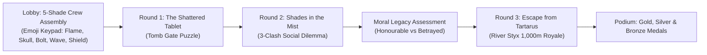
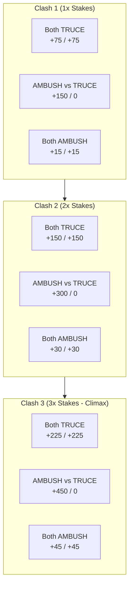
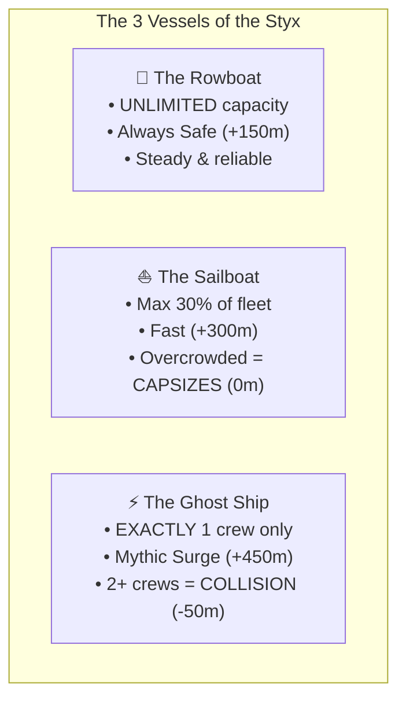

# Underworld Engine: Complete Game Master & Rules Reference Guide

> [!NOTE]
> This master document serves as your complete operational reference for running the game. It details the overarching narrative, the precise mechanics of each round, the mathematical scoring models, the moral legacy carry-over between rounds, and the final escape royale victory conditions.

---

## 🏛️ Overarching Narrative & Atmosphere

The game is set in **Classical Greek Myth** within the subterranean realm of **Tartarus** and the **River Styx**. The aesthetic is dark, ancient gold, and stone, inspired by retro pixel dialogue and classic mythic trials.

### The 5 Complementary Underworld Roles
Every crew must consist of exactly **5 unique roles** (no duplicate roles allowed in a single crew):
1. 🧭 **Navigator** (*Cyan*): Charts currents and celestial markers in the Styx. Breaks ties in Round 2 & 3.
2. 👁️ **Oracle** (*Purple*): Deciphers prophecy, portents, and spectral whispers.
3. 📖 **Scholar** (*Blue*): Translates ancient script and lore from the tomb tablets.
4. 🔥 **Torchbearer** (*Amber*): Keeps the light against the shadows of Tartarus.
5. 🛡️ **Negotiator** (*Bronze*): Represents the table in parleys; breaks voting deadlocks.

The roles don't have any importance in the games. 

---

## 🚪 Round 1: The Shattered Tablet

### 1. Narrative & Lore Briefing
> *"Your crew of five has formed. Walking along Tartarus, you reach a sealed ancient stone door. You need a codeword to pass through. Pieces of a broken ancient stone tablet lie on the ground in front of you. Can you solve it in time to escape this place?"*

### 2. How the Game Works
- The tablet is split into **5 asymmetric vertical slices** distributed across the 5 phones in the crew (Slot #1 to #5).
- Each phone renders high-resolution stone chisel strokes and vector text fragments.
- **Physical Coordination**: Players must physically place their 5 phones side-by-side in numerical order across their pub table (#1 on far left $\rightarrow$ #5 on far right).
- When the screens align, the carved golden fracture lines connect across phone borders, revealing a **2-word ancient codeword** (e.g., `CRIMSON SHADOW`, `TEMPLE RUIN`, `GOLDEN SPHERE`).
- Any teammate can type and submit the answer on their screen.

### 3. Progressive Hints System
If a team gets stuck, hints become available on the Game Master timer:
- **Hint 1 (at 2m 00s)**: Pinpoints who holds the **Far Left fragment** (`#1`).
- **Hint 2 (at 3m 00s)**: Pinpoints who holds the **Far Right fragment** (`#5`).
- **Hint 3 (at 4m 00s)**: Pinpoints who holds the **Center piece** (`#3`).
- **Cost**: Each hint unlocked deducts **-30 PTS** from the team's round score.

### 4. Scoring System & Speed Tiers
Round 1 rewards fast, coordinated physical teamwork:

| Elapsed Solve Time | Speed Tier | Base Points | Net Solve Range (after hints) |
| :--- | :--- | :---: | :---: |
| **0:00 – 1:00** | ⚡ **Legendary** | **300 PTS** | 210 – 300 PTS |
| **1:01 – 2:00** | ⚡ **Swift** | **250 PTS** | 160 – 250 PTS |
| **2:01 – 3:00** | 🛡️ **Steady** | **200 PTS** | 110 – 200 PTS |
| **3:01 – 4:00** | ⏳ **Methodical** | **150 PTS** | 60 – 150 PTS |
| **4:01+** | ⌛ **Standard** | **100 PTS** | **50 PTS** (guaranteed floor) |

> [!TIP]
> The minimum points floor is **50 PTS**. Even if a team takes all 3 hints (-90 PTS) on a 100 PTS solve, they still earn 50 PTS.

---

## 🌫️ Round 2: Shades in the Mist

### 1. Narrative & Lore Briefing
> *"You escape through the ancient door and stumble into a vast, cavernous hall as thick Stygian mist rolls in. Another door swings open to your flank—another crew of shades emerges from the shadows. Are these trustworthy friends, or enemies who will betray you? You must decide before you can move forward."*

### 2. How the Game Works
- Each crew is matched against an **opponent crew** for a **3-Clash Social Dilemma** (Iterated Prisoner's Dilemma).
- Each clash runs through 4 synchronized phases:
  1. **Private Huddle (50s)**: Whispers only at your own table. Agree on your strategy: will you honor peace or strike?
  2. **The Dialogue (40s)**: Turn to the rival table. Look them in the eyes and negotiate your pact across the room. (Bluffing is 100% permitted!).
  3. **Secret Blind Vote (25s)**: Every player privately votes `TRUCE` or `AMBUSH` on their own phone.
     - Team stance is decided by **majority vote** (e.g. 3 vs 2).
     - If tied 2–2, the **Negotiator role** breaks the tie.
  4. **The Debrief / Reveal (40s)**: Stances are dramatically unmasked on screen simultaneously.

### 3. The Escalating Stakes Scoring Matrix

The stakes double and triple across the 3 clashes:

| Stances Revealed | Clash 1 Points | Clash 2 Points | Clash 3 Points | Maximum 3-Clash Total |
| :--- | :---: | :---: | :---: | :---: |
| **Mutual Truce** (`TRUCE` vs `TRUCE`) | **+75** / **+75** | **+150** / **+150** | **+225** / **+225** | **+450 PTS** |
| **The Backstab** (`AMBUSH` vs `TRUCE`) | **+150** / **0** | **+300** / **0** | **+450** / **0** | **+900 PTS** (Aggressor) |
| **Mutual Brawl** (`AMBUSH` vs `AMBUSH`) | **+15** / **+15** | **+30** / **+30** | **+45** / **+45** | **+90 PTS** |

### 4. Moral Legacy & Token Payoffs (Carry-over to Round 3)
Round 2 directly triggers gameplay bonuses and revenge tokens in Round 3:

| Moral Category | Criteria | Round 3 Payoff | Admin Cockpit Badge |
| :--- | :--- | :--- | :--- |
| 🕊️ **Honourable** | Both crews chose `TRUCE` across **all 3 clashes** (unbroken peace). | **Winds of Olympus**: Athena grants **+75m starting distance boost** at the start of Round 3! | `🕊️ +75m Winds` (Emerald) |
| 🩸 **Betrayed** | Crew chose `TRUCE` while rival chose `AMBUSH`. | **Cerberus Treat Token**: Crew can toss a honey-cake treat to Cerberus to drag their backstabber back **-150m** and surge **+150m**. | `🩸 Betrayed (Cerberus)` (Rose) |
| 🗡️ **Aggressor** | Crew chose `AMBUSH` while rival chose `TRUCE`. | **Marked as Nemesis**: Hunted by their victim; Cerberus can be unleashed against them. | `🗡️ Aggressor (Hunted)` (Amber) |
| ⚔️ **Blood Feud** | Both crews traded ambushes equally. | Symmetrical rivalry with no single-victim bonus. | `⚔️ Blood Feud` (Purple) |

---

## 🌊 Round 3: Escape from Tartarus (The Odyssey Escape Royale)

### 1. Narrative & Lore Briefing
> *"You traverse the deep chambers of Tartarus and can finally see the exit portal framed across the wide River Styx. But the terrifying howls of Cerberus echo behind you—Hades's trusted guardian hound is getting near! The door, visible across the far bank, is slowly starting to close. There are precious few minutes left. Can your crew reach the portal before it seals forever?"*

### 2. Point-to-Distance Conversion (The Starting Head-Start)
Cumulative points from Rounds 1 & 2 are converted into starting meters on the River Styx:

$$\text{Headstart Meters} = \min\left(200\text{m}, \left\lfloor\frac{\text{Total Cumulative Points}}{5}\right\rfloor\right)$$

$$\text{Starting Distance} = \text{Headstart Meters} + (\text{Winds of Olympus: } +75\text{m if Honourable})$$

* **Example A (High Scorer, Honourable)**: 1,000 points / 5 = 200m (capped) + 75m Winds of Olympus = **275m starting position**.
* **Example B (Average Scorer, Betrayed)**: 500 points / 5 = 100m + 0m bonus = **100m starting position** (plus holds Cerberus treat token).

### 3. How Escape Waves Work
- **Target Distance**: **1,000 meters** to cross the Styx into the portal.
- **Wave Structure**: 4 scheduled waves, each consisting of:
  1. **Bluff Phase (55s)**: Live room-wide shouting and bluffing. Which vessel will you take?
  2. **Vote Phase (20s)**: Secret blind individual vote for your crew's vessel. (Majority rules; Negotiator breaks ties).
  3. **Reveal & Congestion Phase (25s)**: Simultaneous river movement and capsizing resolution.

### 4. The 3 Escape Vessels

| Vessel | Risk Profile | Fleet Capacity Rule | Success Distance | Failure Distance | Tactical Dynamic |
| :--- | :--- | :--- | :---: | :---: | :--- |
| 🚣 **The Rowboat** | **SAFE** | Unlimited | **+150m** | +150m | Never capsizes. Safe bet when rivals are fighting over bigger vessels. |
| ⛵ **The Sailboat** | **BALANCED** | Max **30% of active fleet** (e.g. max 2 crews in a 7-crew room) | **+300m** | **0m** | Fast advance, but capsizes into freezing waters if crowded. |
| ⚡ **The Ghost Ship** | **SOLO GAMBLE** | **Exactly 1 crew** in the entire room | **+450m** | **-50m** | Huge leap forward. But if 2 or more crews board, they crash into each other (-50m penalty). |

### 5. Cerberus Treat Attack (Revenge Mechanic)
- A crew holding the `🩸 Betrayed` status can toss their honey-cake treat to Cerberus **once per game**.
- They designate their **Nemesis** (the crew that betrayed them in Round 2) and guess what vessel they will pick.
- **If the guess is correct**: Cerberus intercepts the Nemesis on the river!
  - **Nemesis Penalty**: **-150m** dragged backward.
  - **Hunter Bonus**: **+150m** surged forward.

### 6. Sudden Death Duel (The Narrow Gate Standoff)
If two crews cross the 1,000m portal line on the same wave or tie for a podium medal, a **40-second Sudden Death Standoff** triggers:
- Both crews secretly vote on their phone for one maneuver:
  - 🛡️ **Shields** deflects 💥 **Ram**
  - 💥 **Ram** smashes ⛵ **Sails**
  - ⛵ **Sails** outruns 🛡️ **Shields**
- **Deadlock**: If both choose the identical maneuver, the crew with the higher cumulative points from Rounds 1 & 2 wins.

### 7. Victory Conditions & Podium
The first three crews to successfully reach or exceed **1,000 meters** cross through the portal and claim victory:
- 🥇 **Gold Medal**: 1st place escape champion.
- 🥈 **Silver Medal**: 2nd place escape runner-up.
- 🥉 **Bronze Medal**: 3rd place escape finisher.
- All remaining crews are consumed by the shadows of Tartarus.

---

## 📋 Quick-Glance Summary Matrix

| Metric | Round 1 (Tablet) | Round 2 (Mist) | Round 3 (Escape Royale) |
| :--- | :--- | :--- | :--- |
| **Duration** | ~5 – 7 minutes | 3 Clashes (~7 – 9 minutes) | 4 Waves (~7 – 10 minutes) |
| **Primary Skill** | Physical coordination & visual decoding | Social psychology, negotiation & bluffing | Congestion gaming, risk management & room reading |
| **Scoring Unit** | **Points** (50 to 300 PTS) | **Points** (up to 900 PTS) | **Meters** (0m to 1,000m) |
| **Carry-over Effect** | Feeds cumulative score pool | Determines starting head-start & moral legacy tokens | Final victory determination (Podium Medals) |
| **Fail State** | Low points (50 PTS floor) | Low points (0 to 90 PTS on mutual distrust) | Capsizing (0m) or collision (-50m) |
